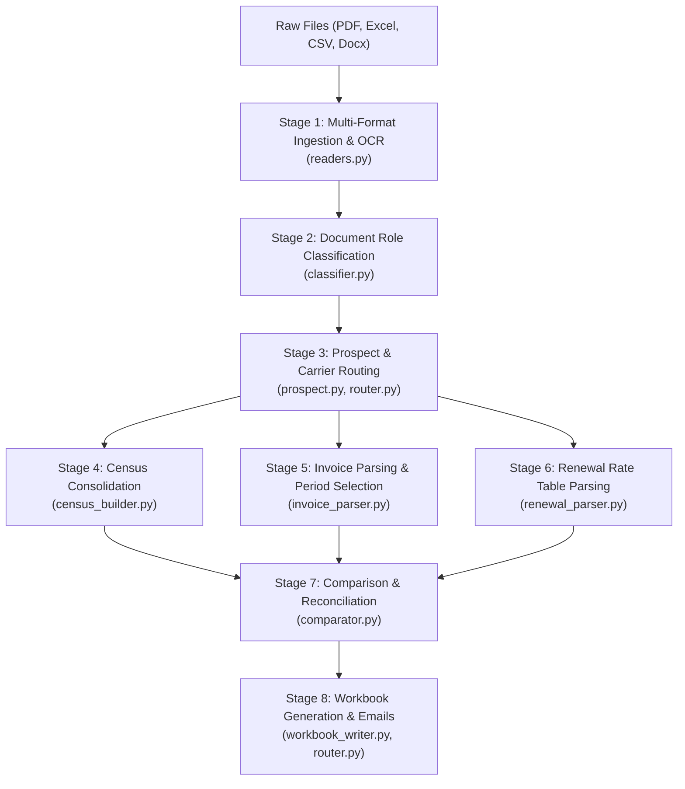

# AI Agent Instructions & Architecture Guide (Census Comparison Agent)

Welcome to the **Census Comparison & Underwriting Automation Agent** codebase (`census_project_claude`).
This document provides instructions, operational guidelines, and architectural rules for AI coding agents and developers working in this workspace.

---

## 1. Controlling Underwriting Instructions

The single controlling operational document for all business logic, document reconciliation, carrier routing, and exception handling is located at:
📁 **[`backend/instructions/Dynamic_Unified_Medical_Submission_Agent_Instruction.txt`](file:///c:/Users/c1755/census_project_claude/backend/instructions/Dynamic_Unified_Medical_Submission_Agent_Instruction.txt)**

### Precedence Hierarchy
1. Current prospect facts & active approved carrier template (`RAPT_Census_-_Template.xlsx` / `Marsh PEO Practice - Census Template - DHR Template.xlsx`).
2. Controlling Business Rules in active instruction document.
3. Carrier-specific routing rules (Florida Blue vs. Cigna).
4. Group-type & document applicability rules.
5. Underwriting invariants, comparison matching, and audit controls.

### Direct Dynamic Access (Zero-Config Hot-Swapping)
- The pipeline, LLM client (`llm_client.py`), and Web UI **directly access the `backend/instructions/` directory on demand**.
- You can simply drop a new instruction file (`.txt`, `.docx`, `.md`, or `.pdf`) into `backend/instructions/` and delete an old one: the system automatically detects the change, loads the new instructions, updates the system prompt, and updates cache fingerprints without any configuration setup or server restart.

Never override a controlling business rule with an informal example or legacy code pattern.

---

## 2. Core Underwriting Invariants

### 2.1 Carrier Routing Matrix
- **Florida Prospects $\to$ Florida Blue**:
  - Primary & only carrier census output: **`RAPT Census - Template`**.
  - **GHQ Requirement**: Required for Florida prospects. Compare GHQ against Census, Invoice/BER, and Renewal.
- **Non-Florida Prospects $\to$ Cigna**:
  - Primary comparison workbook: **`Marsh PEO Practice - Census Template - DHR Template`**.
  - Deliverable: Also populates the **`SBU Census Template`** (population-only; no duplicate comparison).
  - **GHQ**: Not required; cross-document comparison performed only if voluntarily submitted.

### 2.2 Renewal Applicability (PEO 90-Day Rule)
- Renewal comparison is required **only** when:
  1. The prospect is currently with a **PEO**, **and**
  2. The renewal date falls **within the next 90 days**, **and**
  3. No documented mid-term exception makes the renewal inapplicable.
- If not currently with a PEO or renewal date is $>90$ days out, mark `renewal_required = False` and do not flag missing renewals.

### 2.3 Most Used Plan Logic
- Applied strictly to census-only active employees who are absent from the invoice.
- **Never** apply Most Used Plan logic to `WP` (Waiting Period), `NE` (Not Eligible), or `WO` (Waived) employees.

### 2.4 Claims Document Requirements
- Claims documents are required **only** when:
  - Funding type is **Self-Funded** or **Level-Funded**, **and**
  - Enrolled medical employee count exceeds **50**.

### 2.5 Strict Filtering of Non-Employee Data
- **Workers' Compensation (WC) Fragments**: Discard fragments such as `HARRIS, JA WC Code: 0953PA`, `8871LA`, or service fee codes from invoice listings.
- **Payroll Documents**: Documents dominated by wage/tax/payroll withholdings must be classified as `payroll` and never treated as medical invoices.
- **Sanity Premium Guards**: Monthly medical premiums must be realistic (typically $\ge \$100$ for single employee medical; ignore ancillary $\$10-\$25$ dental/vision deductions).

---

## 3. System Architecture (8 Stages)



### Module Responsibilities:
- **`backend/census_config.py`**: Central configuration, dynamic paths, templates, colors, and business constants.
- **`backend/readers.py`**: Resilient ingestion of PDF (PaddleOCR + Poppler fallback), Excel (openpyxl/Calamine), CSV, and Word documents.
- **`backend/classifier.py`**: Field/column alias mapping and document-role classification (`census`, `invoice`, `renewal`, `ghq`, `rfp`, `payroll`).
- **`backend/prospect.py`**: Extracts employer metadata, proposed effective date, SIC/NAICS, address, and broker info.
- **`backend/router.py`**: Determines carrier routing (Florida Blue vs Cigna) and generates ready-to-send Missing Information emails.
- **`backend/census_builder.py`**: Enterprise roster consolidation, dependent linking, date/status normalization, and waiting period calculation.
  - *Tabular spreadsheets parse with 100% fidelity without truncation.*
  - *Unstructured PDF rosters use LLM-First semantic extraction.*
- **`backend/invoice_parser.py`**: Extracts billing period dates, selects latest/revised bill, extracts subscribers, plans, tiers, and premiums.
- **`backend/renewal_parser.py`**: Extracts future renewal rate tables and maps carrier plan tiers.
- **`backend/comparator.py`**: Fuzzy and exact subscriber matching, tier discrepancy detection, and premium reconciliation.
- **`backend/workbook_writer.py`**: Fills output workbooks preserving template formatting (columns A-L underwriting untouched, comparison populated in column M+).
- **`backend/llm_client.py`**: Anthropic Claude integration (`claude-opus-5-5`), prompt caching, robust JSON truncation recovery with backward-walking loop.
- **`backend/caching/`**: Tier 1 local SQLite prompt cache + Tier 2 Anthropic server-side prompt cache.

---

## 4. Development & Testing Commands

### 4.1 Run Web Server & API
```bash
python run_server.py
```
- **Web UI**: [http://127.0.0.1:8000/](http://127.0.0.1:8000/)
- **Swagger Docs**: [http://127.0.0.1:8000/docs](http://127.0.0.1:8000/docs)
- **Health Check**: [http://127.0.0.1:8000/health](http://127.0.0.1:8000/health)

### 4.2 Run Test Suite
```bash
python -m pytest tests/
```
Targeted regression suites:
- `python -m pytest tests/test_slm_ground_truth_regression.py` (SLM ground truth, WC rejection, truncation recovery)
- `python -m pytest tests/test_live_claude.py` (Live Anthropic Claude extraction & instruction validation)
- `python -m pytest tests/test_prompt_caching.py` (Cache hit rates and token reduction)
- `python -m pytest tests/test_invoice_name_filter.py` (Invoice name cleanup)

---

## 5. Coding & Modification Guidelines

1. **Preserve Documentation & Comments**: Never strip existing comments, docstrings, or type annotations.
2. **Tabular Data Fidelity**: Tabular spreadsheets (`.xlsx`, `.csv`) must always be ingested directly via DataFrames to avoid token truncation on enterprise rosters (200+ employees).
3. **JSON Truncation Recovery**: All LLM JSON responses must flow through `_parse_json_robust` in `backend/llm_client.py` to gracefully handle max output token boundaries.
4. **Instruction Integrity**: Do not hardcode instruction text in python modules. Always use `get_official_instructions()` and `get_instruction_doc_names()` from `backend/llm_client.py`.
5. **Always Verify with Tests**: Run `python -m pytest tests/` before and after code changes to guarantee zero regressions.
